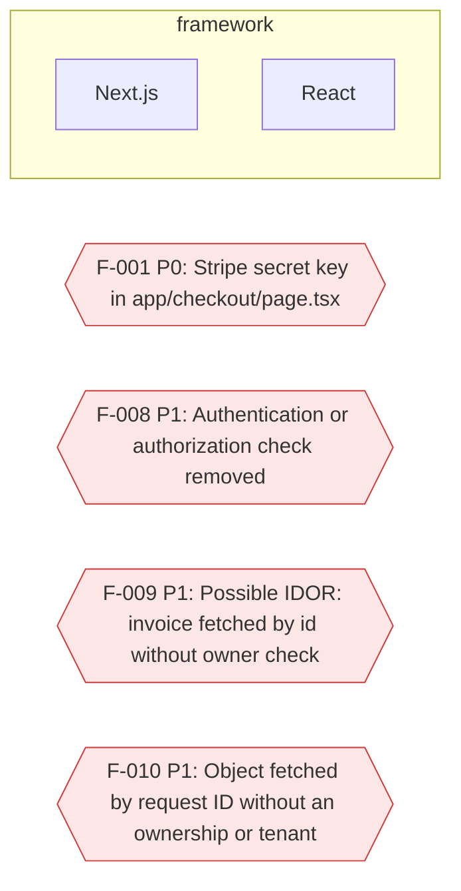
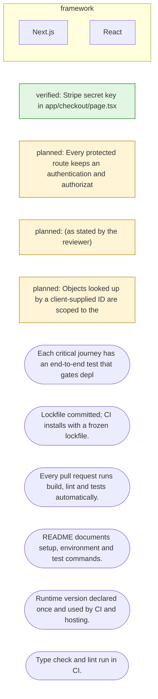

# Product Check blueprint

Target Vibe Invoices (synthetic demo) · scan `PCR-20261108T075100Z-E27953` · _Evidence-bounded: untested areas are unknown, not passed. Not a penetration test, certification or guarantee._

Blueprint = as-is architecture + gaps + to-be architecture + ordered work packets + tests + release gates. Components marked (inferred) and anything in the uncertainty list are not certain.

## As-is architecture and gaps

Uncertainties:

- No deployed application was observed: runtime behaviour, headers and real user experience are unknown.
- No executed test results were imported: whether tests pass is unknown.
- Tenancy model not declared (product.multi\_tenant): isolation requirements are unknown.
- No authentication library detected; whether the product has user accounts or custom auth was not determined.
- Authenticated, multi-step and data-changing journeys were not exercised (no browser automation or credentialed access in this release).

## To-be architecture

- **Each critical journey has an end-to-end test that gates deployment.** — Only executed journeys provide runtime evidence that the product works for users.
- **Lockfile committed; CI installs with a frozen lockfile.** — Reproducible builds are a precondition for meaningful testing and rollback.
- **Every pull request runs build, lint and tests automatically.** — CI is where tests become a gate rather than a suggestion.
- **README documents setup, environment and test commands.** — Reproducible setup is a precondition for testing and handover.
- **Runtime version declared once and used by CI and hosting.** — Runtime drift causes works-on-my-machine failures.
- **Type check and lint run in CI.** — Cheap automated checks catch common defects introduced by fast iteration.

## Ordered work packets

| # | Packet | Sev | Risk | Status | Proposed change |
| --- | --- | --- | --- | --- | --- |
| 1 | `FP-F-008` | P1 | HIGH | PROPOSED | Every protected route keeps an authentication and authorization check. |
| 2 | `FP-F-009` | P1 | HIGH | PROPOSED | (as stated by the reviewer) |
| 3 | `FP-F-010` | P1 | HIGH | PROPOSED | Objects looked up by a client-supplied ID are scoped to the signed-in user or tenant. |

### `FP-F-008` VC-TR-AUTHZ-REMOVED: Authentication or authorization check removed

- Findings: `F-008` (source `RF-2D880E0C81`)
- Where: `app/api/invoices/route.ts`
- Root cause (fact, HIGH): app/api/invoices/route.ts removes 1 line(s) with an auth check (old line 3: const user = await requireAuth(req);) and adds none. Expected: Every protected route keeps an authentication and authorization check.
- User impact: Protected data or actions may become reachable without signing in.
- Tests: reproduction `reproduction:F-008` (command to be declared); regression `regression:unit` → `node --test`
- Negative cases: An unauthenticated request to the affected path is refused (401/403), not served. A signed-in user cannot read or change another user's or tenant's record by changing an ID. No credential or privileged value appears in the client bundle or responses.
- Acceptance: Every protected route keeps an authentication and authorization check. product-check verify --finding F-008 passes at the exact fix commit. Signed human approval(s) for closure (2).
- Rollback: Revert the fix commit (git revert \<fix-sha\>) and redeploy the previous release; follow Revert the release commit and redeploy the previous build. If the fix includes a data migration, run its down step first and confirm with a backup restore test.
- Scope guard: `app/api/invoices/route.ts`, `test/**`, `tests/**`, `**/*.test.*`, `**/*.spec.*`

### `FP-F-009` VC-EXT-CLAIM: Possible IDOR: invoice fetched by id without owner check

- Findings: `F-009` (source `RF-562F5DC1EC`)
- Where: `app/api/invoices/route.ts:2`
- Root cause (hypothesis, LOW): findUnique({ where: { id: params.id } }) is not scoped to the user. Expected: (as stated by the reviewer)
- User impact: As claimed; not machine-checked.
- Tests: reproduction `reproduction:F-009` (command to be declared); regression `regression:unit` → `node --test`
- Negative cases: Error, empty and timeout paths return a handled response, not a crash or silent fallback. Retrying the operation does not repeat its side effect.
- Acceptance: (as stated by the reviewer) product-check verify --finding F-009 passes at the exact fix commit. Signed human approval(s) for closure (2).
- Rollback: Revert the fix commit (git revert \<fix-sha\>) and redeploy the previous release; follow Revert the release commit and redeploy the previous build. If the fix includes a data migration, run its down step first and confirm with a backup restore test.
- Scope guard: `app/api/invoices/route.ts`, `test/**`, `tests/**`, `**/*.test.*`, `**/*.spec.*`

### `FP-F-010` VC-TR-OBJECT-AUTHZ: Object fetched by request ID without an ownership or tenant filter

- Findings: `F-010` (source `RF-B932E49961`)
- Where: `app/api/invoices/route.ts:2`
- Root cause (hypothesis, MEDIUM): app/api/invoices/route.ts:2 looks up a record by a request ID; no user/tenant filter appears in the file. Expected: Objects looked up by a client-supplied ID are scoped to the signed-in user or tenant.
- User impact: Any signed-in user may read or change other users' records (IDOR / cross-tenant leakage).
- Tests: reproduction `reproduction:F-010` (command to be declared); regression `regression:unit` → `node --test`
- Negative cases: An unauthenticated request to the affected path is refused (401/403), not served. A signed-in user cannot read or change another user's or tenant's record by changing an ID. No credential or privileged value appears in the client bundle or responses.
- Acceptance: Objects looked up by a client-supplied ID are scoped to the signed-in user or tenant. product-check verify --finding F-010 passes at the exact fix commit. Signed human approval(s) for closure (2).
- Rollback: Revert the fix commit (git revert \<fix-sha\>) and redeploy the previous release; follow Revert the release commit and redeploy the previous build. If the fix includes a data migration, run its down step first and confirm with a backup restore test.
- Scope guard: `app/api/invoices/route.ts`, `test/**`, `tests/**`, `**/*.test.*`, `**/*.spec.*`

## Test strategy

| Layer | Current | Target |
| --- | --- | --- |
| unit and integration | present | Fast tests for business logic, data access and authorization rules, run on every pull request. |
| end-to-end journeys | absent | One end-to-end test per critical journey (sign-up to first value first), gating deployment; import results with --test-results. |
| security regression | absent | Secret scanning, dependency audit and negative authorization tests in CI; Product Check retest on each release. |
| accessibility | absent | Lint rules plus automated axe checks on key pages. |

## Release gates

Decision **NO_GO**.

| Condition | Status | Detail |
| --- | --- | --- |
| RC-0 Product scan describes the head commit | NOT_EVALUATED | The product scan is for 28d05afb57f3, HEAD is fd2abcf59c99: its verdict and gates describe an older commit. Re-run: product-check retest --baseline \<results\> --repo . --out-dir \<workspace\>, then product-check register. |
| RC-1 No open P0 or failed hard gate | PASS | 0 open P0; failed gates: none (scan is stale; gates not re-checked at HEAD); change-review P0 blockers: 0. |
| RC-2 P1 handled under the CT3 policy (fixed, or a valid unexpired acceptance) | FAIL | 3 P1 without a valid acceptance; 0 expired acceptance(s); change-review P1 blockers: 3. |
| RC-3 Required checks executed and green at the head commit | PASS | Proof PR-29684B79B8: PASS. |
| RC-4 Human approvals valid for the head commit | FAIL | 0/2 valid signed approval(s) (scope change:simplify-invoices). |
| RC-5 Coverage gaps disclosed | PASS | 16 gap(s) disclosed below; overall coverage 50%. |
| RC-6 Targeted fixes retested | PASS | No fix is waiting for verification. |
| RC-7 Rollback or containment available for material risk | PASS | Rollback plan: Revert the release commit and redeploy the previous build. |
| RC-8 No material regression | PASS | No regressed finding or control. |

Generated by Product Check, an EnWithAI Engineering Commons tool. JSON is the source of truth; this file is a rendering.
